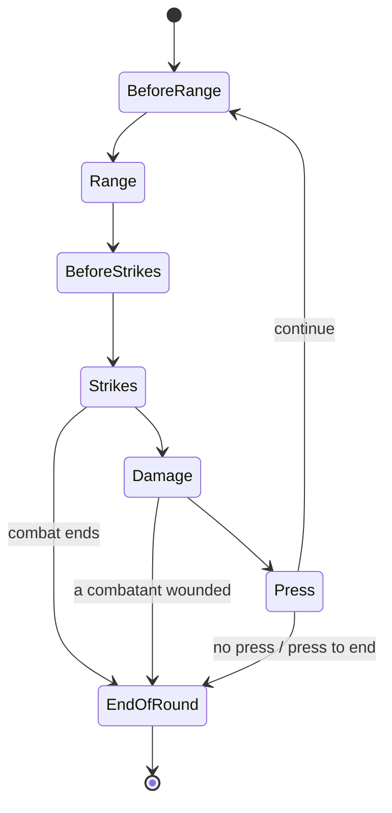

# Design of 25 Sep 2026: event log, shadow model, knowledge sources, bench (copied into git 20 Oct 2026)

**Origin:** the Claude Doc "Elysium Bots — Design: event log, shadow model, knowledge sources, bench" (Johan's, 25 Sep 2026,
https://claude.ai/artifact/S5PiF7x5PhpU4JSSQgp9Dx), copied verbatim below (spec-cleanup-2026-10-20.md §5.4). The doc stays the
original; this copy is the one sessions read.

**Status on 20 Oct 2026 (bot v0.6.211):**
| Part | State |
|---|---|
| 1. Event log | Built: phase A v0.6.176–177 (observe only; the bookkeeping lines typed), phase B v0.6.181–184 (the combat opponent's strike, name, press / maneuver and taken line read from the log; the loose fields deleted). The block paths were not moved. The binding rule is CLAUDE.md "the event log". |
| 2. Episode models in shadow mode | Partly: one combat episode holds the opponent's name (v0.6.182). The action / combat state machines with `shadow-flag` were not built; the abstract model's state skeleton (spec-cleanup §6.1) may supersede them. |
| 3. Real-time invariants | Observe only: `inv-flag` rows read from the log as it grows (v0.6.179–180), `ana-inv.py` after a series. Reconciliation ("the table wins", the bot asking a human) not built; the question is RULINGS O-25. |
| 4. vtes-skill as a source | Used: the cardfx sweep (`REPORT-cardfx-sweep-pilot.md`, `REPORT-cardfx-sweep-full.md`, `spec-cardfx-sweep-sources-2026-09-25.md`) and the archetype labels (v0.6.192). |
| 5. The mirror bench | Built 27 Sep (`bench.sh`, `ana-bench.py`, `REPORT-bench-controls.md`); its port to the sim is round C3 (BOARD). |
| Lessons from VTES-Player | Conservation per transfer = `ana-ledger.py` (offline; the per-match failing row is T10's `ana-gates.py`). Mechanic design notes: not built; RULINGS and ARCHITECTURE carry part of their job. Opponent modelling: the knowledge layer's bricks (v0.6.187–197); the guard rail is CLAUDE.md's knowledge-layer rule. |
| Build order | Steps 1–4 done, 6 in part (`spec-knowledge-layer.md`), 5 and 7 open. |

---

# Elysium Bots — Design: event log, shadow model, knowledge sources, bench

2026-09-25 · @Johan Adamsson

## Purpose and scope

The bot keeps Elysium's free-table design and gains a structured view of what happens at the table, built in four pieces that can ship one at a time.

The free table is the product: humans adjudicate, every card is playable, and bots talk the table's language. The cost showed this week: five state bugs (the handshake, the steal victim, the refused strike, stale fields, stale stealth) that the gates missed for weeks or months. Every one was a state-consistency bug, and every one surfaced only in a ledger read after a series.

| Piece | What it gives | Changes play? |
| --- | --- | --- |
| 1. Event log | One parser, typed events, one source of truth | No |
| 2. Episode models (shadow mode) | Action and combat state machines that flag impossible sequences | No, until switched over |
| 3. Real-time invariants | The ledger checks during play, with the table as the authority | Only the chat when a mismatch matters |
| 4. vtes-skill as a source | Rules, rulings and strategy for the cardfx sweep and the knowledge layer | Indirectly, through better data |
| 5. Mirror bench | Measurement that can tell signal from noise | No |

**Decided:** the free-table design stays; no rules engine; the table wins every disagreement. **Not decided here:** the knowledge layer's own design (it builds on piece 1 and 4) and when the shadow model switches from observing to deciding.

## Part 1 — the event log

Every line and tally the bot receives becomes one typed event in an append-only log, parsed in one place; everything else reads the log.

Today a parsed line writes straight into about twenty loose fields (`_oppStrike`, `_oppPress`, `_oppLastTaken`, `_combatOppName`, `_rowOpp`, `_xtra`, `_stealGain` …). Each needs its own reset at the right moment, and most of this week's bugs were a reset in the wrong place or a line read by the wrong reader.

**Event shape.** `{ seq, t, kind, seat, who, vamp, data, src }` — `src` is the raw line or tally, kept for debugging and the trace.

| Family | Event kinds (first cut) |
| --- | --- |
| Action | `announce` (kind, directed/undirected, target), `resolves`, `blocked` |
| Block | `attempt` (blocker, free intercept), `stealth` (+N or total), `intercept` (+N or total), `verdict` |
| Combat | `combat-start`, `range-set`, `maneuver`, `strike` (kind: hand / card / steal / dodge / ends / aggravated), `extra-strike`, `prevent`, `taken` (n, lost, now, down), `env`, `press` (continue / end), `combat-end` |
| Pool and blood | `bleed` (n, target), `pool-loss`, `pool-gain`, `blood-move` |
| Cards seen | `card-played` (seat, card, discipline shown, window) |
| Table | `turn`, `oust`, `tally` (mode, fields, writer) |

**Rules for the log.**

- One parser module owns every regex (today's `L12`, `NET_*`, the steal / combat-ends / env lines). A new frozen line is a new event kind or a new field, never a new loose variable.
- My own actions enter the log too, as events I emit, so both sides of every exchange live in one place.
- The log is per match and trimmed per turn for memory; the trace keeps the full copy.
- `card-played` is the first feed for the knowledge layer: which disciplines and card types each seat has shown.

**Done when:** the combat and block paths read their inputs from the log, the loose fields are gone, and the suite, canary and ledger stay green.

## Part 2 — episode models in shadow mode

Two small state machines follow the rulebook's sequence, fed only by the event log; in shadow mode they observe and flag, and the current logic keeps deciding.

**Action episode** (one per announced action): `announced → block window → exchange (stealth ↔ intercept) → verdict → resolved | blocked → combat`. Key facts it holds: directed or undirected, base stealth (0 / 1), who may block (target, or predator and prey), who attempted, standing stealth and intercept.

**Combat episode** (one per combat, rounds inside):

**What an episode flags** — an event that cannot happen in the current state, with the state and the event in the flag:

| Flag | Example from this week it would have caught |
| --- | --- |
| Strike from a vampire that is not my opponent | The refused strike (stale block-attempt name), ~4–5 % of combats |
| Steal with no victim-side effect | The steal victim that never lost blood (since v0.6.19) |
| Press or maneuver line never received in a bot-vs-bot combat | The v0.6.114 handshake regression |
| Combat field set before this combat began | Stale `ce` / `rl` / `pr` (v0.6.168) |
| Stealth on the counter that no event of this action produced | Stale stealth from the previous action (v0.6.171) |
| Round 2 strike while the other side is still in Press | The continued-round race (v0.6.159) |

**Shadow mode.** The episode runs beside today's code, never changes a decision, and writes each flag to the trace (`shadow-flag`). A series then shows where the model and the current logic disagree, and each disagreement is either a model bug or a bot bug — both worth knowing.

**Switch-over,** later and one subsystem at a time (combat first): the decision helpers (`_wantPress`, `_wantGrapple`, the block decision) read the episode instead of the loose fields, gated by the suite, the canary and a ledger series.

## Part 3 — real-time invariants and reconciliation

The checks `ana-ledger.py` and `ana-block.py` run after a series run during play instead, and when the bot and the table disagree, the table wins.

| Invariant | Checked at | On a mismatch |
| --- | --- | --- |
| My strike equals their taken (minus their prevent / plus env damage) | Their taken event | Adopt their numbers; flag |
| Blood and pool conserved (my own vampires and pool) | Every blood / pool event | Adopt the table's value; flag |
| Stealth or intercept only while needed | Every stealth / intercept event | Flag (a rule question, not a number) |
| intercept ≥ stealth ⇔ the block succeeds | Verdict | Adopt the verdict line; flag |
| Each side names the other as opponent | Combat start | Learn the name from their lines; flag |
| Every opened tally closes with its action or combat | Resolves / combat-end | Send `mode: null`; flag |

**The table wins.** Humans adjudicate, so a human's line or field that contradicts the model updates the model, never the other way round. The bot speaks only when a mismatch would change what it does next, and asks once, plainly: “I have Lisa at 2 blood — you?” A mismatch that changes nothing is written to the trace and not said.

**Thresholds.** A number mismatch of 1 inside one round is common (prevent cards, strength) and is adopted silently; a mismatch that changes torpor, a combat's end, or a block's verdict is always asked.

**Measured by:** flags per 100 actions in a series, before and after each fix, next to the ledger's pairings; the target is 0 unexplained flags on a bot-only table.

## Part 4 — vtes-skill as the knowledge source

[vtes-skill](https://github.com/vtes-biased/vtes-skill) is MIT-licensed and carries what the next two stages need: the 2024 rulebook verbatim, about 2,600 rulings distilled into principles, and a strategy method with an archetype classification, with live card and TWDA data from KRCG.

| Our need | vtes-skill part | Used for |
| --- | --- | --- |
| Inferior / superior per mode | Rules corpus + rulings | Cardfx sweep: check every mode's `fx` against the card text and its rulings |
| Does `actStealth` include the undirected +1? | Rulebook (undirected actions) + card text | Cardfx sweep: one rule, applied to every action card |
| Does a weapon reach at long range? | Card text + rulings | Cardfx sweep: a `ranged` flag per strike, the gap VTES-Player found on .44 Magnum |
| Which way a political action moves pool, per seat | Card text + rulings | Knowledge layer: a polarity per political card, not a parse of the terms |
| What an opponent's deck is | Archetype classification + TWDA (KRCG) | Knowledge layer: map shown cards to an archetype, then expect its combat, stealth and bounce |
| How an archetype wants to play | Strategy method, modules catalogue | Knowledge layer and personas: posture per archetype (the block doctrine and Tremere's maneuver-vs-press choice Johan deferred to it) |

**Rules for using it.**

- Card text always comes from KRCG, never from memory — the same rule vtes-skill keeps.
- We take its knowledge files as source material with attribution (MIT); VTES game content stays under the Dark Pack agreement.
- The sweep writes our own cardfx data; vtes-skill is the reference we check it against, not a runtime dependency of the bot.

**First step:** read its rules and strategy references and write a mapping note — which reference answers which cardfx field and which knowledge-layer question — before any sweep code.

## Part 5 — the mirror bench

A table-level claim (“this change makes Tremere stronger”) needs 48+ matches per arm and two controls, because two near-identical 12-match series swung a deck by ±12 VP (serie-cmb6 vs cmb7).

**Design.**

- **Mirror seating:** the variant under test sits in every seat position once per design block, the baseline in the others, on the same seeds (the one-seat knob runner `run-t.sh` / `run-m.sh` generalised).
- **Negative control:** baseline against baseline. It must come out a dead heat inside the margin, or the bench is measuring the seating.
- **Positive control:** a deliberately crippled bot (for example `combatMind: 0` plus no blocks) against baseline. It must lose clearly, or the bench cannot see a real difference.
- **Margin:** report mean VP difference per match with a 95 % interval over matches; a claim needs the interval to exclude 0.

| Run | Matches per arm | Expected result |
| --- | --- | --- |
| Negative control (A vs A) | 48 | Difference inside the margin |
| Positive control (crippled vs A) | 48 | Crippled clearly behind |
| Variant vs baseline | 48–96 | The claim, or “no detectable difference” |

**Mechanism counts stay the fast check.** Per-round counts (presses, maneuvers, steals, rushes, flags) move within a 12-match series and remain the day-to-day gate; the bench is for balance and strength claims only.

**Cost:** 48 matches is about 80 minutes at three in parallel; long chains must be split so a tool timeout cannot kill them (serie-cmb2-pre, cmb6m and blk1 each lost matches that way).

## Lessons from VTES-Player, adapted

[VTES-Player](https://github.com/DuelRevolvers/VTES-Player) solves four problems we also have, from the opposite design: a full rules engine that owns the state and offers bots only legal moves. We take the ideas, not the code — the repository shows no licence file, so its code is not reusable.

| Their practice | Our adaptation | Lands in |
| --- | --- | --- |
| Bench with a negative and a positive control | Mirror bench with the same two controls | Part 5 |
| Fuzz games checked by replaying the event log for pool and blood conservation | Conservation checked from the table's lines, per match | Part 3, below |
| One design note per mechanic, citing the rulebook page | Design notes per bot mechanic, with rulebook pages and Johan's rulings | Below |
| First opponent model: other seats modelled with the bot's own formula, from public information only | Knowledge layer: predict a seat from what it has shown, with our own decision helpers | Below |

### Measurement method

**Theirs.** A bench only counts when it carries a negative control (A vs A comes out a dead heat) and a positive one (a crippled policy loses); without both, “no difference” means nothing. They measure before designing, on more than one deck, and report every result with its margin — their playstyle bench landed inside ±0.252 VP and they made no strength claim from it.

**Ours.** The same two controls and margins, on our mirror seating (Part 5). We add two things of our own: mechanism counts per round as the fast daily gate, and pre-registered predictions for every series, which already caught that cmb6's balance swing was noise.

**What we do not copy:** their per-decision measurement inside an engine (“16 % of strikes at long range”) needs the engine's full option list; our equivalent is the trace rows (`combat-round`, `decide`), which give the same kind of number from the bot's side.

### Conservation checks

**Theirs.** Seeded four-seat games play to the end, and after each game the event log is replayed to prove that pool and blood were conserved, blood stayed within capacity and every actor was locked at announcement. A failure reports its seed; widening from 10 to 120 seeds found two engine faults the 10 never reached.

**Ours.** We have no engine to replay, but we have both sides' lines. Every transfer between two seats must appear on both sides and balance:

| Transfer | Sender's record | Receiver's record | Balances when |
| --- | --- | --- | --- |
| Bleed | `through` n (+ modifiers) | `took-bleed` n | Equal after the actor's modifier cards |
| Strike damage | `combat-round` dealt | their `combat-round` taken | Equal after prevent, env damage, combat ends |
| Steal | `stole` | `stolenFromMe` | Equal, or the victim's blood was lower |
| Referendum pool | vote outcome terms | `took-pooldmg` via referendum | Equal per named seat |
| Creeping Sabotage | placement | `took-pooldmg` via creep, each turn | One burn per copy per turn |

**Adaptation.** Today `ana-ledger.py` checks this after a series. The next step is to run it inside every arena match and fail the match row with its seed, as their fuzz does — so a series cannot quietly contain an unbalanced transfer. A wider seed sweep (their 10 → 120 lesson) becomes a periodic run, not the daily gate.

### Mechanic design notes

**Theirs.** Over 200 design notes, one per mechanic that took a decision, each quoting the rulebook page it relies on; the rule is to read the note before touching the mechanic. Their CLAUDE.md holds only what is binding and true — rules, current counts, pointers — and was cut back twice after history re-grew in it.

**Ours today.** The knowledge is real but scattered: long comments in `elysium-bot.js`, a CHANGELOG entry per release, rulings in memory files, and a CLAUDE.md whose version handshake keeps growing.

**Adaptation.** One short note per bot mechanic, each with the same five parts: the rule (rulebook page), Johan's rulings (dated), how the bot implements it (functions, knobs), the tests that pin it, and the known limits.

| First notes to write | Holds today's scattered knowledge on |
| --- | --- |
| combat-phases | The seven steps, Johan's phrases, the clock, the Damage step |
| block-exchange | Stealth / intercept only when needed, undirected +1, chat numbers, stale stealth |
| combat-rules | Long-range fists, aggravated damage, dodge, combat ends, wounded ends combat |
| steal | Both sides, the one-line shape, dodge undoes it |
| combat-decisions | Grapple gating, press worth, range posture, rush kit, seize the moment |
| tally-protocol | Fields as data, lines as the contract, closes, stale-field guard |

CLAUDE.md then keeps the binding rules (the ledger gate, knob hygiene, lines as the contract) and points to the notes; release history stays in the CHANGELOG.

### Opponent modelling

**Theirs.** Their first opponent model covers votes only: another seat's polling decision is predicted with the same formula the bot uses itself, computed from a state already redacted for the bot — so the modelled opponent never knows more than the bot, only less. It is guarded, not the default, and they make no strength claim. They note the hard part plainly: a real reply model needs sampling the opponent's hidden cards, which is always a guess because deck lists are private.

**Adaptation for the knowledge layer.**

1. **Evidence from public events only:** the event log's `card-played`, blocks attempted, combat cards shown, stealth and intercept used — never a seat's hidden hand.
2. **A prior from the archetype:** shown cards and disciplines map to an archetype (vtes-skill's classification, TWDA via KRCG), which gives an expectation of combat, stealth, intercept and bounce for cards not yet seen.
3. **Predict with our own helpers:** “would this seat press, maneuver, block?” is answered by running our `_want*` helpers from that seat's side, with its shown resources — their “same formula” idea.
4. **Scope it small and measure:** start with the questions Johan deferred to this layer — expected combat from a seat (Tremere's maneuver vs press, Malkavian's wave, the block doctrine) — and bench each one (Part 5) before the next.

**Guard rail:** the model may make the bot cautious or bold; it never lets the bot act on information a human in that seat could not have.

## Build order, gates and risks

The order follows what each piece unlocks: the knowledge sources and the event log first, because the cardfx sweep and the knowledge layer need them anyway.

| Step | Piece | Gate before the next step |
| --- | --- | --- |
| 1 | vtes-skill mapping note (Part 4) | Johan agrees which references answer which questions |
| 2 | Cardfx sweep + inferior/superior, checked against vtes-skill | Suite, canary, a ledger series; the `actStealth` and `ranged` questions closed |
| 3 | Event log (Part 1), with `card-played` feeding the knowledge layer | Loose combat/block fields gone; suite, canary, ledger green |
| 4 | Mirror bench (Part 5): controls first | Negative control inside the margin, positive control clearly behind |
| 5 | Episode models in shadow mode (Part 2) + real-time invariants (Part 3) | 0 unexplained shadow flags on a bot-only series |
| 6 | Knowledge layer design, on steps 1–5 | Its own design doc and Johan's rulings |
| 7 | Switch-over, combat first | Bench shows no loss; ledger and shadow flags stay at 0 |

**Risks and what contains them.**

- **A refactor that breaks what works.** Contained by shadow mode (no decisions change) and by switching one subsystem at a time.
- **The event log grows into a second engine.** It records what the table said; it never enforces a rule on a human.
- **vtes-skill drifts from KRCG or from our reading.** Card text always comes from KRCG; where a ruling and our cardfx disagree, the question goes to Johan.
- **Bench runs cost time and die at tool limits.** Split chains into short, resumable groups; report partial runs as partial.

## Open questions for Johan

- [x] Is the build order right, or should the event log come before the cardfx sweep? Decided 25 Sep: the recommended order — vtes-skill mapping, cardfx sweep, event log, bench, knowledge layer.
- [ ] When the bot and a human disagree on a number, should the bot ask in chat every time it matters (Part 3), or only log it during playtests?
- [x] Should the mirror bench run before the knowledge layer is designed, so its first claims are measured from day one? Decided 25 Sep: yes, the bench comes before the knowledge layer.
- [x] Is vtes-skill acceptable as a reference source (MIT, with attribution), or should the sweep stay on KRCG and the rulebook alone? Decided 25 Sep: yes, as a reference; card text still comes from KRCG.

## Sources

- [VTES-Player README](https://github.com/DuelRevolvers/VTES-Player) — architecture, limitations, tests
- [VTES-Player CLAUDE.md](https://github.com/DuelRevolvers/VTES-Player/blob/main/CLAUDE.md) — bench controls, fuzz invariants, design notes, the AI items and their opponent model
- [vtes-skill](https://github.com/vtes-biased/vtes-skill) — rules corpus, rulings synthesis, strategy method, MIT licence
